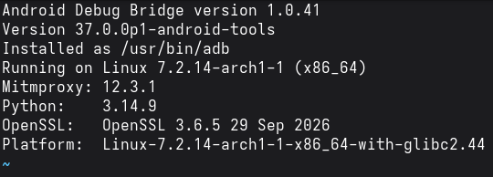
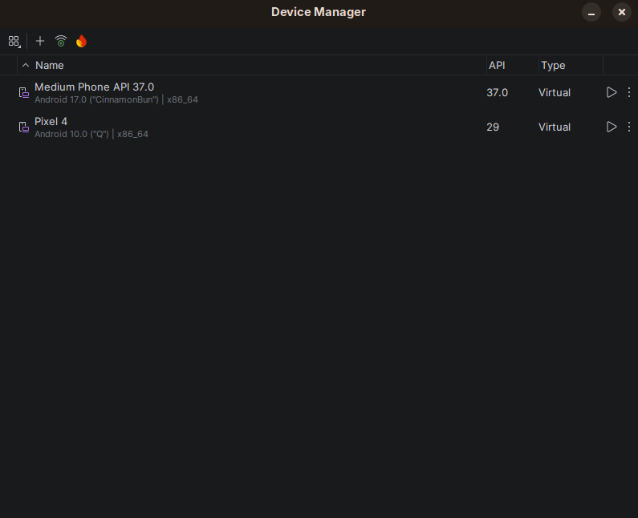
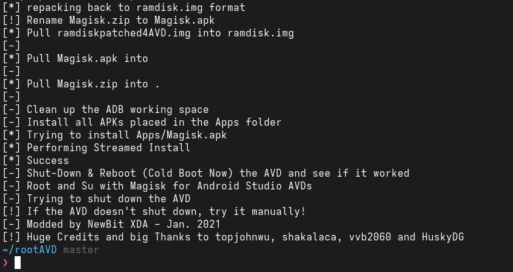
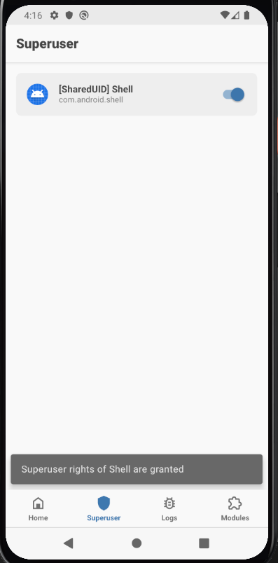
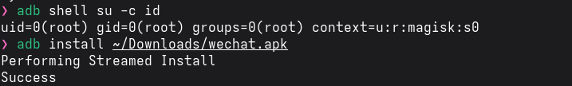
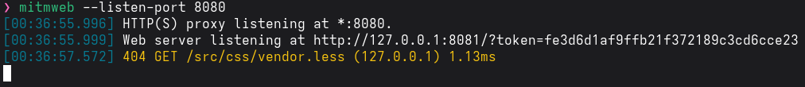
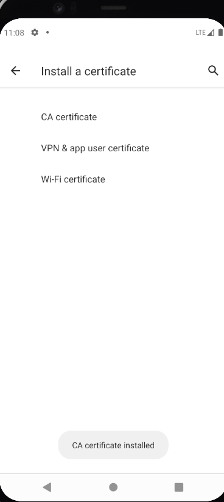
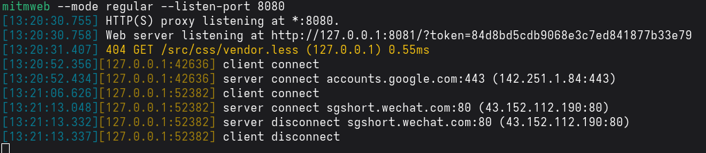
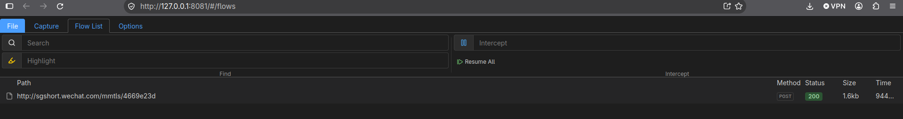
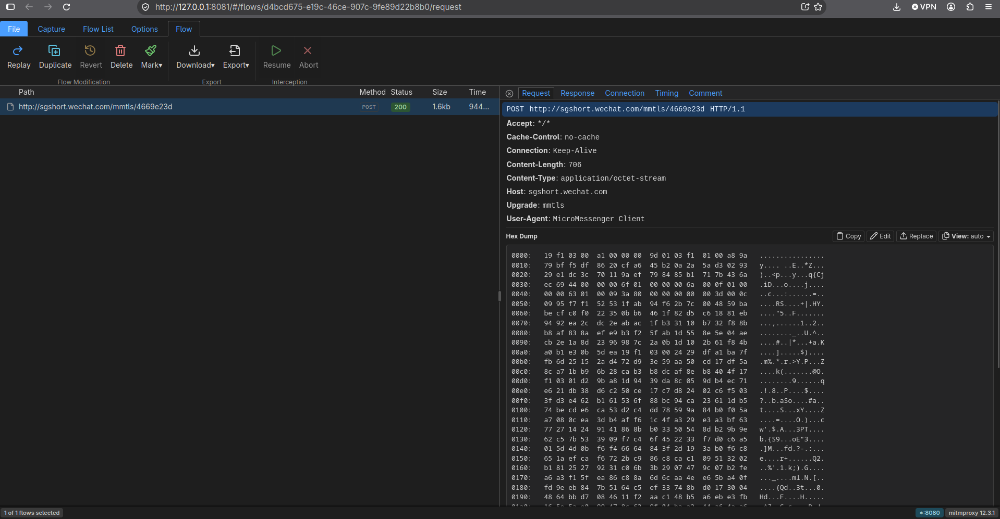

# WeChat Traffic Interception

Intercepting WeChat's network traffic on a rooted Android emulator using mitmproxy, to see what's actually exposed at the transport layer and what WeChat protects with its own encryption.

**Setup:** Arch Linux host, Android emulator (API 30, Google Play image) rooted with Magisk via rootAVD, mitmproxy as the intercepting proxy.

## Stack

- Android Studio AVD — Pixel 4, API 30, Google Play, x86_64
- [rootAVD](https://github.com/newbit1/rootAVD) + Magisk — root access
- [mitmproxy](https://mitmproxy.org/) — traffic interception
- [MagiskTrustUserCerts](https://github.com/AeonLucid/MagiskTrustUserCerts) — forces apps to trust user-installed CA certs
- iptables DNAT — redirects traffic to the proxy (WeChat ignores the system HTTP proxy setting)

## Result

WeChat's traffic rides on HTTP, but the payload is encrypted separately with Tencent's own **MMTLS** protocol (`Upgrade: mmtls` header, `application/octet-stream` body). So even with a fully trusted MITM position — root, custom CA, proxy redirect all working — the actual message content stays opaque. Only metadata is visible: endpoints, timing, request sizes.

See [`findings.md`](findings.md) for details.

## Steps

### 1. Environment setup
Android Studio, SDK, mitmproxy, Frida/objection installed via pacman/yay/pip.


### 2. Emulator
Pixel 4, API 30, Google Play image (needed for ARM64 translation — WeChat ships arm64-v8a only).


### 3. Root via Magisk
```bash
./rootAVD.sh system-images/android-30/google_apis_playstore/x86_64/ramdisk.img
```



### 4. Install WeChat
```bash
adb install wechat.apk
```



*Note: newer WeChat builds (8.0.x) kept crashing on launch — likely anti-tamper checks reacting to root. Dropped to an older build (7.0.x), which ran clean.*

### 5. mitmproxy
```bash
mitmweb --mode regular --listen-port 8080
```


### 6. Trust the CA system-wide
User-installed certs aren't trusted by apps by default on Android 7+. Installed the mitmproxy CA as a user cert, then used the **MagiskTrustUserCerts** module to make the system trust it the same way it trusts built-in CAs — no need to touch the read-only `/system` partition directly (blocked by dm-verity on this image anyway).



### 7. Redirect traffic to the proxy
WeChat ignores the system HTTP proxy setting entirely — it uses its own networking stack with direct socket connections. Standard `transparent` mode also failed (`SO_ORIGINAL_DST` doesn't work across the emulator's virtual network). Fixed by switching mitmproxy to **regular** mode (it resolves the real target via TLS SNI) plus iptables DNAT on the device:
```bash
iptables -t nat -A OUTPUT -p tcp --dport 80 -j DNAT --to-destination 10.0.2.2:8080
iptables -t nat -A OUTPUT -p tcp --dport 443 -j DNAT --to-destination 10.0.2.2:8080
```


### 8. Captured traffic
```
POST http://sgshort.wechat.com/mmtls/4669e23d
```


### 9. Payload inspection
Headers are readable (`Upgrade: mmtls`, `User-Agent: MicroMessenger Client`), but the body is opaque binary — MMTLS encryption, separate from and on top of the TLS/HTTP layer we're already intercepting.

